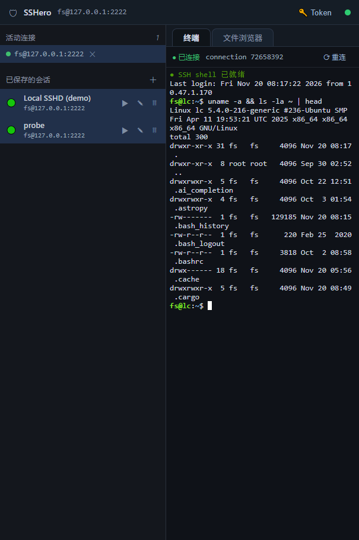
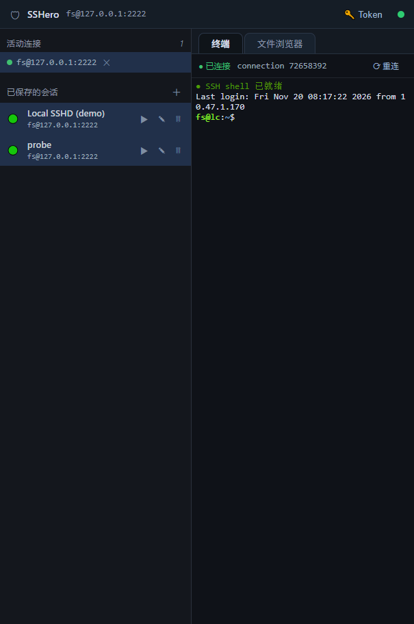
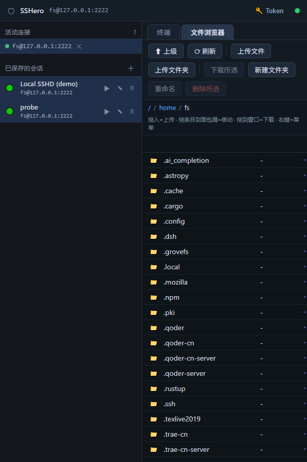
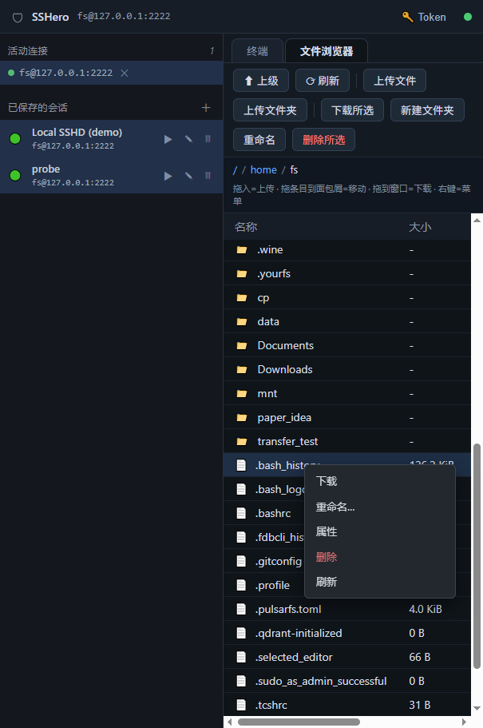

<div align="center">

# 🛡 SSHero

**A good-looking SSH workbench: interactive PTY terminal and SFTP file manager, side by side in one native window.**

Built with a **Rust** backend ([russh](https://crates.io/crates/russh) + [axum](https://crates.io/crates/axum)) and a **Vue 3 / TypeScript** frontend, shipped as a cross-platform desktop app (Electron / Tauri v2).

A WindTerm-style layout — saved sessions on the left, **Terminal** and **Files** tabs on the right — with drag-and-drop upload/download and full right-click file operations.

[](LICENSE)


**English** · [简体中文](README.zh-CN.md)

</div>



---

## Why SSHero

Most SSH tools make you pick a side: a terminal **or** a file transfer client. SSHero puts both in one window, backed by a single Rust process, so you can `cd` in the terminal and watch the file pane follow — then drag a folder straight onto the remote directory.

- **One window, two panes** — persistent session sidebar + `Terminal` / `Files` tabs.
- **Real drag-and-drop** — drop local files/folders to upload; the bytes go straight from disk to SFTP, never through the webview.
- **Streaming folder transfer** — directories download as a streamed `tar.gz`, upload preserves the tree structure.
- **Runs everywhere** — native desktop app (Electron or Tauri v2), *and* the same UI in a browser against the local backend.
- **Secure by default** — random loopback port + random token per launch, TOFU host keys, secrets never echoed back.

## Screenshots

| Interactive PTY terminal (xterm.js) | Remote file browser (SFTP) |
|---|---|
|  |  |

Right-click any file for **Download / Rename / Properties / Delete**, or right-click empty space to **New folder / Upload file / Upload folder**:



## Features

| Capability | Desktop (Tauri / Electron) | Browser |
|---|---|---|
| Session profiles (CRUD; password / key-path / pasted-key auth) | ✅ | ✅ |
| Interactive PTY terminal (xterm.js, live bidirectional, resize) | ✅ | ✅ |
| SFTP browse / breadcrumb / properties / new / rename / recursive delete | ✅ | ✅ |
| Drag local files/folders to upload | ✅ OS drag → abs path → `/upload-path` (no webview copy) | ✅ HTML5 File API + recursive entries |
| Drag-to-download / right-click download | ✅ native save dialog → `/download-to-local` | ✅ browser blob download |
| Folder download | ✅ streamed `tar.gz` | ✅ streamed `tar.gz` |
| Right-click context menus (item + blank area) | ✅ | ✅ |

## Quick start

### Desktop app — Electron (verified on Ubuntu 20.04)

```bash
cd frontend && npm install && npm run build     # -> frontend/dist
cd .. && cargo build --release                  # -> target/release/sshero-backend
cd apps/electron && npm install
npm start                                       # opens the native window
```

### Desktop app — Tauri v2 (Ubuntu 22.04+ / Debian 12+ / Windows / macOS)

> Tauri v2 hard-requires `libwebkit2gtk-4.1`, which Ubuntu 20.04 does not ship. The
> `apps/desktop` crate is complete and spec-compliant; on a machine with 4.1 just run
> `cargo tauri build` to produce deb/rpm/AppImage/dmg/msi.

```bash
cd frontend && npm install && npm run build
cargo install tauri-cli --version "^2"
cd apps/desktop && cargo tauri dev              # hot-reload dev
cargo tauri build                               # package installers
```

### Browser mode (dev / self-check)

```bash
cargo run -p sshero-backend -- --listen 127.0.0.1:18901 --static frontend/dist
# open http://127.0.0.1:18901/
```

The production binary auto-detects `frontend/dist` and serves the SPA, so the exact same
UI runs in a browser.

### Build installers (one click)

```bash
bash scripts/build-all.sh     # everything this host can produce
bash scripts/build-linux.sh   # AppImage + deb + tar.gz
bash scripts/build-windows.sh # NSIS installer + portable (cross-built from Linux)
bash scripts/build-macos.sh   # dmg (must run on a Mac)
```

Artifacts land in `apps/electron/dist/`.

## Architecture

```
backend/            Rust backend (lib + bin)
  src/lib.rs        spawn() / generate_token(): embedded by the desktop shell
  src/main.rs       standalone CLI (browser mode)
  src/api.rs        REST routes (sessions, connections, SFTP, path transfers)
  src/ws.rs         WebSocket <-> remote PTY bridge (russh channel split)
  src/sessions.rs   persisted session profiles (sessions.json, 0600)
  src/ssh.rs        russh client, TOFU host keys, auth, SFTP subsystem
  src/fsop.rs       list/stat/upload/download, tar.gz streaming pipe, rm/rename
frontend/           Vue 3 SPA (shared by Tauri and browser)
  src/App.vue       WindTerm layout (topbar + sidebar + dual-tab workspace)
  src/api.ts        typed HTTP client
  src/bridge.ts     Tauri detection / token / drag events / save dialog
  src/components/   Sidebar · SessionDialog · TerminalTab · FilesTab · ContextMenu …
apps/desktop/       Tauri v2 shell (sidecar backend, random port + token)
apps/electron/      Electron shell (spawns backend as a child process)
scripts/            one-click build scripts per platform
```

### Tech stack

| Layer | Choice | Version |
|---|---|---|
| SSH / SFTP / PTY | [`russh`](https://crates.io/crates/russh) + [`russh-sftp`](https://crates.io/crates/russh-sftp) | russh 0.65 / russh-sftp 2.x |
| HTTP / WS | [`axum`](https://crates.io/crates/axum) + tokio | axum 0.8 / tokio 1 |
| Desktop shell | **Tauri v2** or **Electron 33** | 2.x / 33.x |
| Frontend | Vue 3 `<script setup lang="ts">` + Vite + vue-tsc | vue 3.5 / vite 8 |
| Terminal | `@xterm/xterm` + `addon-fit` | 6.0 / 0.11 |
| Archive | `tar` + `flate2` (streaming `tar.gz`) | — |

## Security model

- **Desktop mode** — the shell generates a **random loopback port + random 64-bit token**
  on every launch, handed to the SPA via `?token=`; the SPA attaches it as the
  `X-SSHero-Token` header and WS query. Neither port nor URL is predictable, and other
  local processes are blocked by the token even if they reach the loopback socket.
- **Browser mode** — optional `--token SECRET` or `SSHERO_TOKEN`; without it the server
  binds bare `127.0.0.1` (local-only).
- **TOFU host keys** — first connection is recorded to `<data-dir>/known_hosts.json`;
  later key changes are refused.
- **Session profiles** — `sessions.json` and pasted keys (`keys/<id>.pem`) are written with
  `0600`; the API only ever returns `has_password` / `has_key` booleans, never the secret.
- `--disable-local-fs` turns off the two local-path endpoints for pure-browser deployments.

## Known limitations (honest list)

1. **Tauri v2 shell** can't compile on Ubuntu 20.04 (missing `libwebkit2gtk-4.1`); use the
   Electron shell there, or a newer distro. The code is complete and builds on 22.04+.
2. **Password auth** path is code-complete but not exercised on real hardware (the local
   test sshd only enables public-key).
3. **Drag-out to a system folder** has no native webview→OS event; use right-click
   "Download / Save to…" instead (both work).
4. Folder `tar.gz` does not preserve permission bits / owner / mtime (uniform `0644`);
   a single file is buffered fully in memory before being archived.
5. SFTP v3 has no group/owner names — only numeric uid/gid; directory size is the inode value.

## License

MIT — see [LICENSE](LICENSE).
