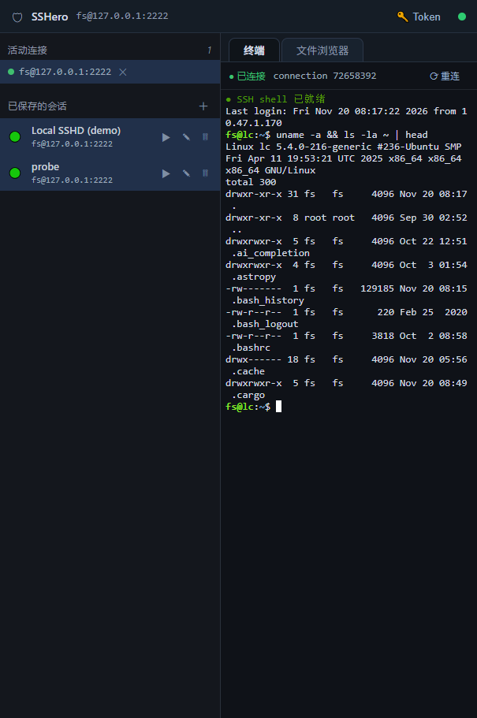
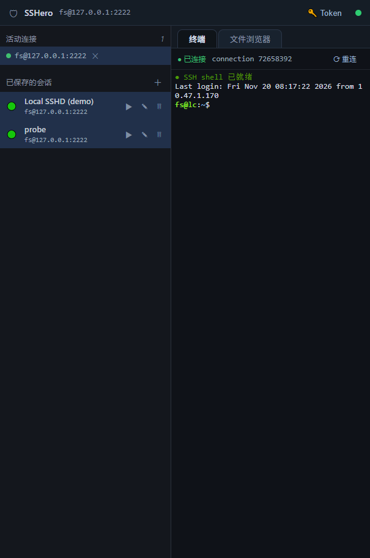
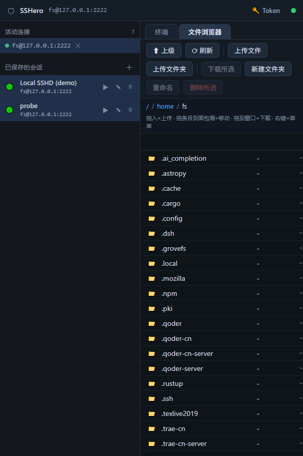
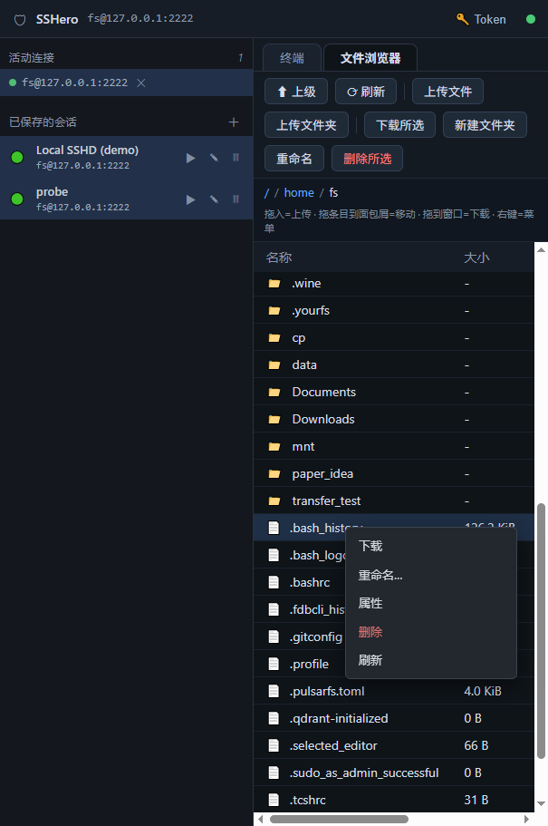

<div align="center">

# 🛡 SSHero

**一个高颜值的 SSH 工作台：交互式 PTY 终端 + SFTP 文件管理，并排在同一个原生窗口里。**

后端用 **Rust**（[russh](https://crates.io/crates/russh) + [axum](https://crates.io/crates/axum)），前端用 **Vue 3 / TypeScript**，
打包成跨平台桌面应用（Electron / Tauri v2）。类 WindTerm 布局 —— 左侧持久化会话管理，
右侧「终端 / 文件」双 Tab，支持拖拽上传下载与右键文件操作。

[](LICENSE)


[English](README.md) · **简体中文**

</div>



---

## 为什么是 SSHero

大多数 SSH 工具逼你二选一：要么一个终端，要么一个文件传输客户端。SSHero 把两者放进同一个窗口，
背后只有一个 Rust 进程——你可以在终端里 `cd`，文件面板随之而动，然后直接把本地文件夹拖到远程目录上。

- **一窗双栏** —— 会话侧栏常驻，右侧 `终端` / `文件` 双 Tab。
- **真·拖拽** —— 拖入本地文件/文件夹即上传，字节**直接从磁盘走 SFTP，不经过 webview**。
- **流式文件夹传输** —— 目录下载为流式 `tar.gz`，上传保留整棵目录树结构。
- **到处能跑** —— 原生桌面应用（Electron 或 Tauri v2），同一套 UI 也能在浏览器里连本机后端。
- **默认安全** —— 每次启动随机回环端口 + 随机 token，主机密钥 TOFU，密钥永不回显。

## 截图

| 交互式 PTY 终端（xterm.js） | 远程文件浏览器（SFTP） |
|---|---|
|  |  |

右键任意文件行 → **下载 / 重命名 / 属性 / 删除**；右键空白区 → **新建文件夹 / 上传文件 / 上传文件夹**：



## 功能矩阵

| 场景 | 桌面（Tauri / Electron） | 浏览器 |
|---|---|---|
| SSH 会话档案管理（增删改查；密码 / 密钥路径 / 私钥内容 三种认证） | ✅ | ✅ |
| 交互式 PTY 终端（xterm.js，实时双向、支持 resize） | ✅ | ✅ |
| SFTP 浏览 / 面包屑 / 属性 / 新建 / 重命名 / 递归删除 | ✅ | ✅ |
| 拖入本地文件/文件夹上传 | ✅ OS 拖拽→绝对路径→`/upload-path`（无 webview 拷贝） | ✅ HTML5 File API + 递归条目 |
| 拖出下载 / 右键下载 | ✅ 原生保存对话框→`/download-to-local` | ✅ 浏览器 blob 下载 |
| 文件夹下载 | ✅ 流式 `tar.gz` | ✅ 流式 `tar.gz` |
| 右键上下文菜单（条目 / 空白区两种） | ✅ | ✅ |

## 快速开始

### 桌面应用 —— Electron（本机 Ubuntu 20.04 已实测通过）

```bash
cd frontend && npm install && npm run build     # 产出 frontend/dist
cd .. && cargo build --release                  # 产出 target/release/sshero-backend
cd apps/electron && npm install
npm start                                       # 打开原生窗口
```

Electron 启动流程：`main.cjs` 生成随机 token → spawn 后端 `--listen 127.0.0.1:0 --token <t>
--ready-file <tmp>` → 后端 bind 后写入实际端口 → Electron 读取并打开 `BrowserWindow` 指向
`http://127.0.0.1:<port>/?token=<t>`。窗口关闭时子进程 SIGTERM。

### 桌面应用 —— Tauri v2（Ubuntu 22.04+ / Debian 12+ / Windows / macOS）

> **注意**：Tauri v2 硬依赖 `libwebkit2gtk-4.1`，Ubuntu 20.04 官方仓库不提供，故本机
> workspace 已把 `apps/desktop` 从 members 中暂时注释；改用 Electron 或换较新发行版即可。
> 代码/配置按 Tauri v2 官方规范编写，在满足依赖的机器上直接 `cargo tauri build` 即可产出
> deb/rpm/AppImage/dmg/msi。

```bash
cd frontend && npm install && npm run build
cargo install tauri-cli --version "^2"          # 一次性
cd apps/desktop && cargo tauri dev              # 热重载开发
cargo tauri build                               # 打包 deb/rpm/AppImage/dmg/msi
```

发布前生成图标：`cargo tauri icon <1024x1024.png>`。要在 Linux 上启用桌面壳编译，把顶层
`Cargo.toml` 的 `members` 改回 `["backend", "apps/desktop"]`。

### 浏览器模式（开发 / 自检）

```bash
cargo run -p sshero-backend -- --listen 127.0.0.1:18901 --static frontend/dist
# 打开 http://127.0.0.1:18901/
```

生产二进制会**自动探测** `frontend/dist` 并托管 SPA，浏览器里看到的是同一套 UI。

### 一键构建安装包

```bash
bash scripts/build-all.sh     # 本机能力全集：Linux 主机产出 Linux 三件套 + Windows 安装器
bash scripts/build-linux.sh   # AppImage + deb + tar.gz
bash scripts/build-windows.sh # NSIS + portable（Linux 主机交叉构建，需 mingw-w64、wine + wine32）
bash scripts/build-macos.sh   # 仅限 Mac 执行：dmg（arm64 + x64）
```

脚本幂等可重复执行；产物统一输出到 `apps/electron/dist/`，脚本末尾打印清单。

#### 产物与验证状态

| 平台 | 产物 | 状态 |
|---|---|---|
| Linux x64 | `sshero-0.2.0-x86_64.AppImage` | ✅ 已实测（Xvfb 启动，包内嵌后端 + 包内嵌 SPA 均确认） |
| Linux x64 | `sshero-0.2.0-amd64.deb` | ✅ 内容已抽查 |
| Linux x64 | `sshero-0.2.0-x64.tar.gz` | ✅ 解包即用 |
| Windows x64 | `sshero-0.2.0-x64.exe`（NSIS 安装器） | ✅ 未签名，首次运行 SmartScreen 会提示 |
| macOS | — | ⚠️ 在 Mac 上执行 `bash scripts/build-macos.sh`（dmg 工具链仅 macOS 可用） |

打包原理：`prepack.sh` 把 `target/<triple>/release/sshero-backend[.exe]` 复制到
`apps/electron/bin/`，electron-builder 通过 `extraResources` 嵌入安装包；运行时 `main.cjs`
优先从 `process.resourcesPath/bin/` 加载内嵌后端，开发环境回退到 `target/release`。
SPA 必须作为普通目录 `resources/frontend-dist` 嵌入（Rust 后端进程读不了 asar）。
`.cargo/config.toml` 已配置 mingw / aarch64 / musl 交叉链接器。

## 目录结构

```
backend/                Rust 后端（作为 lib + bin）
  src/lib.rs            spawn() / generate_token()：桌面壳内嵌启动
  src/main.rs           CLI 独立运行（浏览器模式）
  src/api.rs            REST 路由（sessions、connections、SFTP、路径传输）
  src/ws.rs             WebSocket ↔ 远程 PTY 桥接（russh channel split）
  src/sessions.rs       持久化会话档案（sessions.json，0600）
  src/ssh.rs            russh 客户端、TOFU 主机密钥、认证、SFTP 子系统
  src/fsop.rs           目录列表/属性/上传下载/tar.gz 流式管道/删除/重命名
frontend/               Vue 3 SPA（Tauri 与浏览器共用）
  src/App.vue           WindTerm 布局（顶栏 + 左栏 + 双 Tab 工作区）
  src/api.ts            类型化 HTTP 客户端
  src/bridge.ts         Tauri 检测 / token / 拖拽事件 / 保存对话框
  src/components/
    Sidebar.vue         活动连接 + 已保存会话（右键菜单）
    SessionDialog.vue   会话 CRUD（密码 / 密钥路径 / 私钥内容 三种认证）
    TerminalTab.vue     xterm.js + WS PTY
    FilesTab.vue        文件列表 / 面包屑 / 右键菜单 / HTML5 拖拽上传下载
    ContextMenu.vue     通用上下文菜单
    PropertiesDialog.vue 属性对话框
    ComboDialog.vue     通用输入对话框（新建/重命名/token/密码）
apps/desktop/             Tauri v2 桌面壳（sidecar 内嵌后端）
apps/electron/            Electron 桌面壳（spawn 后端为子进程 + BrowserWindow）
scripts/                 一键构建脚本（见「发行包」章节）
.probe/                 本地 sshd 测试实例与冒烟脚本（可整目录删除）
```

## 技术栈

| 层 | 选型 | 版本 |
|---|---|---|
| SSH / SFTP / PTY | [`russh`](https://crates.io/crates/russh) + [`russh-sftp`](https://crates.io/crates/russh-sftp) | russh 0.65 / russh-sftp 2.x |
| HTTP/WS | [`axum`](https://crates.io/crates/axum) 0.8 + tokio 1 | 0.8.x |
| 桌面壳 | **Tauri v2**（推荐）或 **Electron 33**（本机可选） | 2.x / 33.x |
| 前端框架 | Vue 3 `<script setup lang="ts">` + Vite + vue-tsc | vue 3.5 / vite 8 |
| 终端模拟器 | [@xterm/xterm](https://www.npmjs.com/package/@xterm/xterm) + addon-fit | 6.0 / 0.11 |
| 打包传输 | `tar` + `flate2`（文件夹 tar.gz 流式管道） | — |

> TypeScript 锁定 `~5.9`（vue-tsc 尚不兼容 TS 7 的包结构导出）。

## API 一览（`/api`）

| 方法/路径 | 作用 |
|---|---|
| `GET /health` | 存活探针 |
| `GET /sessions` / `POST /sessions` / `PUT /sessions/{id}` / `DELETE /sessions/{id}` | 会话档案 CRUD（密钥字段永不回显） |
| `POST /sessions/{id}/connect {secret?}` | 用档案建立 SSH 连接（未持久化密钥时可临时提供） |
| `GET /connections` / `DELETE /connections/{id}` / `POST …/reconnect` | 活动连接管理 |
| `POST /connections` | 直接用 raw ConnectParams 建连（无档案） |
| `GET …/list?path=` / `GET …/stat?path=` | 目录列表 / 单项属性 |
| `POST …/mkdir` / `POST …/remove` / `POST …/rename` | 变更操作（remove 支持 recursive） |
| `GET …/download?path=` / `GET …/download-dir?path=` | 单文件 / 目录 tar.gz 流式下载 |
| `POST …/upload?dir=&rel=` | 请求体原始字节流上传（rel 可含子路径） |
| `POST …/upload-path {dir, local_path}` | **桌面专用**：上传本地绝对路径（文件或目录）到远程 `dir` |
| `POST …/download-to-local {path, dest}` | **桌面专用**：把远程文件/目录（tar.gz）写入本地绝对路径 |
| `GET …/terminal?cols&rows` (WebSocket) | 交互式 PTY：binary=字节，text=JSON 控制帧 `{type:"resize"\|"exit"\|"error"}` |

## 安全模型

- **桌面模式**：壳每次启动生成 **随机回环端口 + 随机 64 位 token**（进程生命周期内存活），
  通过 URL `?token=` 交给 SPA；SPA 将 token 附于 `X-SSHero-Token` 头与 WS query。端口/URL
  无法被外部预测，同机其他进程即使连上回环也会被 token 挡住。
- **浏览器模式**：可选 `--token SECRET` 或 `SSHERO_TOKEN` 环境变量；不加则默认裸监听
  127.0.0.1，仅本机可用。
- **主机密钥 TOFU**：首次连接记录到 `<data-dir>/known_hosts.json`，之后密钥变更拒连。
- **持久化会话档案**：`<data-dir>/sessions.json` 与 `<data-dir>/keys/<id>.pem`（粘贴的私钥）
  权限 `0600`；API 只回传 `has_password` / `has_key` / `has_key_passphrase` 布尔位，绝不回显。
- `--disable-local-fs` 可关闭两个本地路径接口（纯浏览器部署推荐）。

## 已知限制（诚实清单）

1. **Tauri v2 桌面壳**：代码/配置齐全，但本机 Ubuntu 20.04 缺 `libwebkit2gtk-4.1`，
   `cargo check -p sshero-desktop` 无法运行；顶层 workspace 已把 `apps/desktop` 从 members
   中暂时注释。同一 UI/协议在 **Electron 壳**（`apps/electron/`）中已在本机 Xvfb 下实测通过。
2. **密码认证分支未在真机验证**：本地 sshd 只开了公钥；`russh::authenticate_password`
   代码路径同构但未实测。
3. **拖出到系统文件夹**：webview→OS 反向拖拽在 Tauri/Electron 均无原生事件；前端会引导
   用户走右键"下载"/"保存到…"，两条路径都工作。
4. 文件夹下载 tar.gz 内不保留权限位/属主/mtime（统一 0644）；单文件先完整缓冲到内存再
   写入归档，峰值 ≈ 最大单文件。
5. SFTP v3 不提供属组名/属主名，只显示 uid/gid 数值；目录大小是 inode 值。

## 冒烟测试复现（Linux）

```bash
# 1) 启动非特权 sshd（本机 "远程"）
sshd -f .probe/sshd_config -E .probe/sshd.log          # 监听 127.0.0.1:2222

# 2) 启动后端
cargo run -p sshero-backend -- --listen 127.0.0.1:18901 --data-dir .probe/data

# 3) 传统 SFTP 全链路（v1 脚本）
bash .probe/smoke.sh

# 4) v2 新特性（sessions CRUD / PTY WS / upload-path / download-to-local）
bash .probe/smoke2.sh
```

## 许可

MIT —— 见 [LICENSE](LICENSE)。
